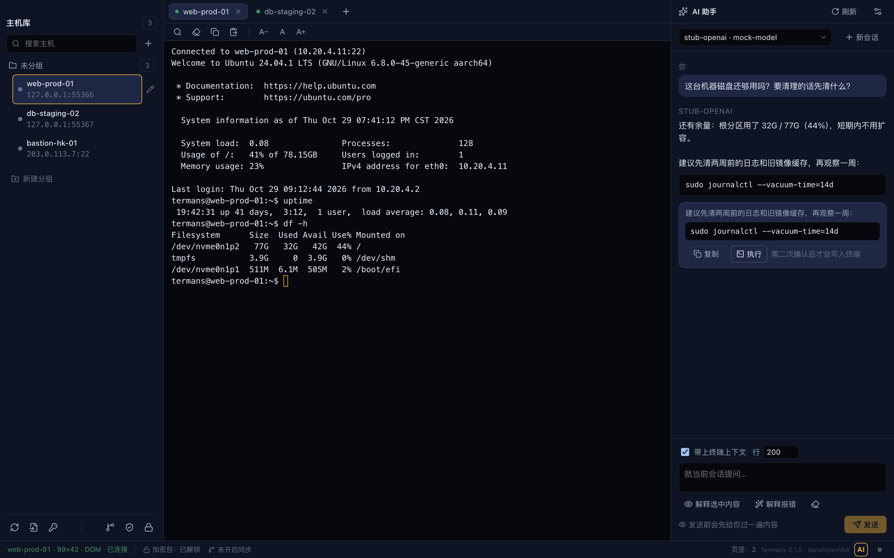

# Termans

跨平台 SSH 客户端：多页签终端、加密主机库、Git 同步、AI 辅助、可换主题与多语言。
Electron + React + xterm.js + ssh2；主机库同步走 isomorphic-git，仓库里只有密文。

> 阶段说明：当前为 **0.1.0（P4 里程碑）**。macOS 已实跑验证（arm64 与 x64 产物均能启动）；
> Windows / Linux 的打包配置就绪但**尚未在真机产出并验证**。产品未签名、未公证，也没有自动更新。



---

## 1. 功能一览

| 能力 | 说明 |
| --- | --- |
| 多页签终端 | xterm.js（WebGL 渲染，失败自动回退 DOM）、自适应尺寸、搜索、选中即复制、右键粘贴、链接走系统浏览器 |
| 主机库 | 分组树、标签、搜索、跳板机（ProxyJump）、端口转发、启动命令、备注；支持从 `~/.ssh/config` 导入/导出 |
| 加密主机库 | 主口令（scrypt + AES-256-GCM）端到端加密；IP、端口、用户名、密码、passphrase、known_hosts、ssh_config 全在密文里 |
| Git 同步 | 自己的仓库（GitHub/GitLab/自建 http(s)），只推 `manifest.json` + `vault.enc` + `themes/*.json`；换机后解锁即可看到主机 |
| 私钥 | 私钥文件本体**永不同步**；只在主机上记路径引用。缺文件时连接前明确报错，并给「导入私钥 / 粘贴私钥 / 改用密码」三个入口 |
| AI 辅助 | 11 个供应商预设 + 自定义；流式对话、带终端上下文；**生成的命令必须先确认**才写入终端 |
| 主题 | 4 套内置（Dark / Midnight / Light / High Contrast）+ 自定义主题编辑器（导入导出、实时预览） |
| 多语言 | English / 简体中文，即时切换 |
| 安全默认 | known_hosts 严格校验、空闲 15 分钟自动上锁、锁定时界面上不渲染任何主机名与 IP |

---

## 2. 安装与第一次运行

### 2.1 产物清单

| 平台 | 产物 |
| --- | --- |
| macOS arm64 | `Termans-0.1.0-arm64.dmg` / `Termans-0.1.0-arm64-mac.zip` |
| macOS x64 | `Termans-0.1.0.dmg` / `Termans-0.1.0-mac.zip` |
| Windows x64 | `Termans Setup 0.1.0.exe`（NSIS，可选安装目录） |
| Linux x64 | `Termans-0.1.0.AppImage` / `termans_0.1.0_amd64.deb` |

### 2.2 macOS：未签名产物的 Gatekeeper 拦截（第一次打开必读）

产物**没有 Developer ID 签名、也没有公证**。本机构建出来的 `.app` 没有 quarantine 属性，双击能开；
但任何通过浏览器 / 微信 / AirDrop / U 盘传出去的 dmg 或 zip 都会被 macOS 打上 `com.apple.quarantine`，
首次打开会报「Termans 已损坏，无法打开」或「无法验证开发者」。**这不是包坏了**。

两种自解方法（任选其一）：

1. **右键 → 打开**（或在「系统设置 → 隐私与安全性」页面底部点「仍要打开」）。只需一次，之后正常双击。
2. **命令行去隔离**（适合脚本分发 / CI）：

   ```bash
   xattr -dr com.apple.quarantine /Applications/Termans.app
   ```

想确认是不是这个原因：

```bash
$ xattr -l /Applications/Termans.app | head -3        # 有 com.apple.quarantine 就是被隔离了
$ spctl --assess --type execute -vv /Applications/Termans.app
```

### 2.3 Windows

未签名产物会被 SmartScreen 拦一次：点「更多信息 → 仍要运行」；或下载后右键 exe →
「属性 → 常规 → 勾选『解除锁定』」。

### 2.4 Linux

```bash
chmod +x Termans-0.1.0.AppImage && ./Termans-0.1.0.AppImage      # AppImage
sudo dpkg -i termans_0.1.0_amd64.deb && termans                   # deb
```

---

## 3. 第一次运行：主口令与恢复码

1. 首启是**锁定态**：没有任何主机信息可看。第一次需要「创建主口令」。
2. 主口令 **≥ 12 个字符**。弱口令（如 `password1234`、`aaaaaaaaaaaa`、`qwertyuiopas`）会给出熵值警告，
   并要求**同一口令再提交一次**才算确认——这是刻意的摩擦，不是 bug。
3. 创建后会**一次性显示 32 位恢复码**（`XXXX-XXXX-…`，Crockford base32，约 160 bit）。请立刻保存：
   界面提供「下载」按钮，存成文件或抄进密码管理器。
4. 之后每次启动输入主口令即可解锁；勾选「记住本机 7 天」会把会话密钥交给系统钥匙串保管
   （macOS Keychain / Windows DPAPI / Linux libsecret），7 天内免输。
5. 忘记主口令时，用「用恢复码重置」：输入恢复码 + 新主口令即可重设。
   恢复码**不是一次性的**（可以反复用来重置），也可以随时在「安全」面板里「重新生成恢复码」——
   那会换新盐、`revision` 加一，结果是**旧恢复码失效、必须重新 push 一次**。

> 空闲 15 分钟自动上锁（可在设置里改，0 = 关闭）；系统休眠也会上锁。

---

## 4. 加密模型与三条必须知道的代价

### 4.1 仓库里到底有什么

同步仓库里**只有三类文件**，没有明文主机信息：

| 文件 | 内容 | 敏感 |
| --- | --- | --- |
| `manifest.json` | 明文元数据：`format`、`cipher`、KDF 参数（N/r/p）、`revision`、`payload_sha256`、`updated_at` | 否（不含任何主机名/IP） |
| `vault.enc` | **唯一敏感载体**：主机（IP/端口/用户/密码/passphrase/私钥路径/跳板机/分组/标签/备注/启动命令）、known_hosts 指纹、完整 `ssh_config` 文本、界面设置、AI 供应商配置与 API key | 是（密文） |
| `themes/*.json` | 自定义主题 | 否（明文，便于 diff） |

密钥层次：主口令经 **scrypt(N=2^17, r=8, p=1, salt 32B)** 派生出 KEK，KEK 用 **AES-256-GCM** 包裹一个随机 32 字节的
VMK（主数据密钥），VMK 再加密 `vault.enc`。恢复码是独立的一条包裹路径（自己的 salt），所以换口令不影响它。
AAD 绑定格式版本与 KDF 参数，篡改任何一位都会解密失败。细节见 [`docs/VAULT-SYNC.md`](docs/VAULT-SYNC.md)。

私钥文件本体、Git token 的本机副本不进仓库（私钥只同步路径引用）。

### 4.2 三条代价（请当真）

1. **不可恢复**：主口令忘了、恢复码也丢了，数据就真的打不开了——没有后门、没有客服重置、没有「找回密码」。
   恢复码只可能在**已解锁的会话里**重新生成，所以首次创建时那份必须存好。
2. **历史旧密文仍在**：Git 历史里躺着历次提交的 `vault.enc`，每一份都是用**当时的主口令**加密的。
   轮换主口令**不会重加密历史提交**。所以：如果旧主口令泄露过，加上对方能拿到仓库历史，他仍能解出当时的密码。
   这种情况不要「就地轮换」了事，应当把远端仓库重建（新仓库、新历史）后再同步。
3. **泄露处置 = 轮换主口令 + 轮换所有已同步过的密码**：`vault.enc` 里是能直接用的凭据。一旦主口令或恢复码外泄、
   且对方拿到了仓库，就应当把所有同步过的主机密码视为已泄露，逐个在服务器上改掉——只改主口令是不够的。

---

## 5. Git 同步配置

1. 准备好一个**空仓库**（GitHub / GitLab / 自建均可），远端地址用 **http(s)**：
   `https://github.com/<you>/termans-vault.git`。
   ⚠️ 本版本**不支持 `ssh://` 远端**（isomorphic-git 只实现 http(s) 传输），填 `ssh-agent` 会明确报错。
2. 在「Git 同步」面板填：远端地址、分支（默认 `main`）、认证方式（Token 或 无）。
   Token 建议用细粒度 PAT，只给这一个仓库的 contents 读写权限。
3. 点「连接」：本地已有内容会推上去；本地为空会从远端 clone 下来，随后用主口令解锁即可看到主机。
4. 之后「推送 / 拉取」手动同步（后续里程碑加自动同步）。状态含义：
   `idle` 已同步 / `ahead` 本地有新提交 / `behind` 远端有新提交 / `diverged` 需要解决冲突 / `error` 出错。
5. **冲突不是静默覆盖**：密文无法三路合并，所以用 `revision` + `payload_sha256` 做乐观锁，冲突时逐字段让你选
   「保留本地 / 保留远端 / 两个都留（复制一份）」。密码类冲突只显示掩码，界面上不会出现明文密码。
   冲突快照写在 `vault-local/conflicts/`（本机，不进仓库）。

> Token 在解锁后随密文包同步；只有「首次 clone 还没解锁」时才用本机保存的那份。所以**换机后第一次连接需要重输 Token**。

---

## 6. AI 供应商配置

1. 设置 → AI：内置 11 个预设（OpenAI、DeepSeek、Moonshot、DashScope、OpenRouter、vLLM、LM Studio、
   Ollama、Anthropic、Gemini、Gemini 原生），也可以选「自定义」填 base URL 与模型名。
2. 填 API key → 保存。key 进加密包（`vault.enc`），**不进任何明文文件**；界面与日志里只显示尾 4 位。
3. 侧边栏 AI 面板：发送前会展示「将要发送的内容」——包含终端最近 N 行上下文（默认 200 行，可调）。
   不想要上下文就关掉。
4. AI 生成的命令**必须点确认**才会写入终端；危险命令（`rm -rf /`、`dd of=/dev/…`、`mkfs`、`curl | sh` …）
   会额外红色告警。这是硬约束，不能一键跳过。

---

## 7. 主题与语言

- 主题：4 套内置（Dark / Midnight / Light / High Contrast）+ 自定义主题编辑器。
  自定义主题只存差异项、可导入导出 JSON；对比度不足会警告但不阻止保存。
  主题走 52 个 `--ts-*` CSS token，xterm 配色同源，切换即时生效。
- 语言：设置里切换 English / 简体中文，即时生效并持久化；首启按系统语言选择。
  日期、数字、相对时间走 `Intl`，不是硬编码格式。

---

## 8. 快捷键

macOS 用 `⌘`，Windows / Linux 用 `Ctrl`。

| 快捷键 | 动作 |
| --- | --- |
| `⌘ T` | 新建页签（选主机 / 快速连接） |
| `⌘ W` | 关闭当前页签（活跃会话需二次确认） |
| `⌘ ]` / `⌘ [` | 下一个 / 上一个页签（也支持 `⌘ PageDown/PageUp`、`Ctrl Tab`） |
| `⌘ 1` … `⌘ 9` | 跳到第 N 个页签（`⌘ 9` = 最后一个） |
| `⌘ F` | 终端内搜索 |
| `⌘ K` | 清屏 |
| `⌘ =` / `⌘ +` / `⌘ -` | 放大 / 缩小字号，`⌘ 0` 复位 |
| `⌘ ⇧ C` | 复制全部输出 |
| `⌘ ⇧ V` | 粘贴（多行粘贴会提示：仅作为文本插入，不自动执行） |

鼠标：选中即复制、右键粘贴、中键或双击关闭页签。

---

## 9. 数据放在哪

全部在 Electron 的 `userData` 目录下（`app:info` 会返回真实路径；macOS 通常是
`~/Library/Application Support/<应用名>`，开发态与安装包的应用名不同，所以路径也不同）。

| 路径 | 内容 | 进 Git |
| --- | --- | --- |
| `vault/manifest.json` | 明文元数据 | ✅ |
| `vault/vault.enc` | 唯一敏感载体（密文） | ✅ |
| `vault/themes/*.json` | 自定义主题 | ✅ |
| `vault-local/credentials.json` | 本机凭据：Git token、导入的私钥（safeStorage 或 `machine.key` 包裹） | ❌ |
| `vault-local/session.json` | 「记住本机 7 天」的会话密钥封装 | ❌ |
| `vault-local/local.json` | 本机状态（远端配置、上次同步的 revision） | ❌ |
| `vault-local/machine.key` | 系统钥匙串不可用时的兜底密钥（0600） | ❌ |
| `vault-local/conflicts/` | 冲突快照与 `state.enc` | ❌ |
| `settings.json` | 界面 / 终端 / 安全设置（非敏感） | ❌ |

> AI 会话历史 v1 **只在内存**（重启即失，不落盘）：聊天记录里必然出现 `user@1.2.3.4`、命令输出、
> 内网路径，写成明文 JSON 会和「仓库里 grep 不到 IP、锁屏不显示主机信息」的姿态自相矛盾。跨重启的
> 历史留到「加密历史」里程碑（写进 `vault.enc`）。老版本遗留的明文 `ai-conversations.json*` 会在启动时被删掉。


> `machine.key` 只是「静态混淆」——系统钥匙串不可用时才用，**不等于**硬件保护。想强一点就把
> 「记住本机」关掉，每次启动输主口令。

---

## 10. 从源码运行与构建

要求：Node ≥ 20（开发机实测 Node 26.11.1）、pnpm 10（实测 10.34.7）、macOS / Windows / Linux。

```bash
pnpm install            # .npmrc 已固定 Electron 与 electron-builder 的 npmmirror 镜像
pnpm dev                # electron-vite 开发模式（渲染层热更新）
pnpm typecheck          # node + web 两个 project 都要过
pnpm test               # vitest，单文件跑更快：npx vitest run src/main/vault
pnpm test:e2e           # playwright（会先 pnpm build）

pnpm pack               # 生成安装包（按 electron-builder.yml 的 arch 列表）
pnpm pack:dir           # 只出当前架构的目录包 dist/<platform>/Termans.app
node scripts/pack-guard.cjs verify   # 校验图标三处一致 + 原生模块架构 + 产物元数据
```

**交叉打包后必须恢复本机架构**：在 arm64 Mac 上打 x64 包时，`@electron/rebuild` 会把 `node_modules` 里的原生模块
就地改成 x86_64，随后 `pnpm dev` / vitest / e2e 都会加载错架构的二进制。
打包流程已挂 `afterAllArtifactBuild` 钩子自动恢复（失败就非 0 退出）；构建中途崩溃时手动跑：

```bash
node scripts/pack-guard.cjs restore
```

打包细节、三平台步骤、版本号策略、图标判定表见 [`docs/RELEASING.md`](docs/RELEASING.md)。

---

## 11. 已知限制

1. Windows / Linux 的产物**配置就绪但未在真机验证**（本机只有 macOS）。
2. 无代码签名、无公证、无自动更新。
3. Git 远端只支持 http(s)（不支持 `ssh://`、`git://`）。
4. 冲突解决粒度是「字段」，不是行级文本合并；`ssh_config` 文本整体作为一个冲突项。
5. 系统休眠自动上锁已在主进程接好（`powerMonitor.on('suspend')` → `vaultManager.lock()`，见 `src/main/ipc/index.ts`）；个别 Linux 桌面环境的 suspend 事件可能不触发，空闲上锁不受影响。
6. 没有 SFTP / 文件传输界面（引擎侧能力留待后续里程碑）。
7. 数据库式并发未建模：同一账号在多台机器同时改同一台主机，靠乐观锁 + 人工选边处理。

---

## 12. 文档索引

| 文档 | 内容 |
| --- | --- |
| [`docs/ARCHITECTURE.md`](docs/ARCHITECTURE.md) | 技术栈、目录归属、安全基线、IPC 契约、环境坑 |
| [`docs/SPEC.md`](docs/SPEC.md) | 功能与非功能验收判据（含加密同步 S-01…S-21、A→B 迁移） |
| [`docs/VAULT-SYNC.md`](docs/VAULT-SYNC.md) | 加密格式、KDF 参数、锁定 UX、Git 同步状态机、冲突合并规则、与契约的偏差 |
| [`docs/ai-providers.md`](docs/ai-providers.md) | 各供应商差异、流式/重试/超时语义、上下文注入、命令确认 |
| [`docs/theming.md`](docs/theming.md) | 52 个 token、内置主题、自定义主题与对比度规则 |
| [`docs/i18n.md`](docs/i18n.md) | namespace 约定、缺 key 兜底、术语表 |
| [`docs/TESTING.md`](docs/TESTING.md) | 测试分层与本地跑法 |
| [`docs/RELEASING.md`](docs/RELEASING.md) | 三平台打包步骤、产物清单、版本号策略、图标/架构校验 |

---

## English essentials

**Termans** is a cross-platform SSH client (Electron + React + xterm.js + ssh2) with a multi-tab terminal,
an end-to-end encrypted host vault, Git-based sync, AI assistance, themes and English/简体中文 UI.

- **Install**: take the artifact for your platform from the release page. Builds are **unsigned and not notarized**.
  On macOS, if the app is blocked by Gatekeeper, either **right-click → Open** (once), or run
  `xattr -dr com.apple.quarantine /Applications/Termans.app`. On Windows, SmartScreen → "More info → Run anyway".
- **First run**: create a master passphrase (≥ 12 chars, weak ones require a second confirmation), then
  **save the 32-character recovery code** shown once. Forgot the passphrase? Use the recovery code to reset it.
- **Encryption**: passphrase → scrypt(N=2^17, r=8, p=1) → KEK → AES-256-GCM → wraps a random 32-byte vault key →
  encrypts `vault.enc`. The repo only holds `manifest.json` (metadata), `vault.enc` (ciphertext) and `themes/*.json`.
  Private key material is never synced, only paths.
- **Three costs you must accept**: (1) *no recovery* — lose both passphrase and recovery code and the data is gone;
  (2) *old ciphertext stays in Git history* — rotating the passphrase does not re-encrypt past commits, so treat a
  leaked old passphrase plus repo history as a leak and start a fresh repo; (3) *leak response* = rotate the master
  passphrase **and** rotate every password that was ever synced.
- **Git sync**: http(s) remote + token only (no `ssh://`). Conflicts are never silently overwritten: you resolve them
  field by field (keep local / keep remote / keep both).
- **AI**: 11 provider presets or a custom base URL; keys live inside the encrypted vault; every generated command
  must be confirmed before it is written to the terminal.
- **Shortcuts**: `⌘/Ctrl T` new tab, `⌘/Ctrl W` close, `⌘/Ctrl ] [` cycle, `⌘/Ctrl 1…9` jump, `⌘/Ctrl F` find,
  `⌘/Ctrl K` clear, `⌘/Ctrl ±` font size, `⌘ ⇧ C` copy all.
- **Develop**: `pnpm install`, `pnpm dev`, `pnpm typecheck`, `pnpm test`, `pnpm test:e2e`, `pnpm pack`.
  After a cross-arch pack (e.g. x64 on an arm64 Mac), run `node scripts/pack-guard.cjs restore`
  (the build hook does it automatically; this is the manual fallback).
